# Glow ME Liquid Glass 2차 검토

기준 **f52d48c** 대비 실제 Chromium 캡처입니다. 같은 합성 자료·화면 크기·상태를 사용했고, Channel은 같은 로컬 MP4의 1초 프레임입니다. 앱 화면은 standalone 배치 모의이며 실제 OS 설치가 아닙니다. 가상 대화/계정은 테스트에만 존재하고 앱에 추가하지 않았습니다.

## 부족했던 원인과 변경

- 기존 탭 바는 거의 불투명한 흰 면, 검색은 93% 이상의 밝은 면과 1px 반사선으로 헤더와 재질이 달랐습니다. 최신 시안의 넓고 휘어진 반사광·두꺼운 이중 가장자리·볼록한 캡슐 광택이 부족했습니다.
- 상단 물결 파일은 유지하고 아쿠아 조색과 곡면 모서리 하이라이트를 강화했습니다. 탭 바와 패널에는 새로 생성한 조용한 유리 반사 재료를 공유하고, 안팎 림/아래쪽 굴절색/부드러운 그림자를 겹쳤습니다.
- 선택 메뉴/탭·날짜 이동·검색·다운로드는 곡면 광택, 일반 탭은 약하게 유지합니다. 헤더 텍스트 대비를 보강하고 저장 버튼은 기존 녹색 의미를 유지합니다.
- 기존 12px/8px 간격, 열 너비/서랍/PWA 배치, 투명 로고, 중간 투표/사이드바 중복 제거를 보존했습니다. 모든 주요 컨테이너 경계 좌표는 기준과 동일합니다.
- 대화 본문과 실제 영상/컨트롤에는 새 반사광이나 이미지를 입히지 않았습니다. 큰 고정 패널 blur:none, 좁은 웹 사이드바만 기존 2px 유지. JS/인증/재생/다운로드/Native/확장/PWA 캐시/Hooks 변경 없음.

## 실제 전후 화면

각 이미지를 누르면 원본 PNG가 열립니다. 전후 크기는 동일하며 이미지 합성/색 보정 없이 브라우저가 그린 결과입니다. 아래 확대는 해당 DOM 영역을 원본 해상도로 캡처한 것입니다.

### 일반 웹 1440×900

| 수정 전 f52d48c | 수정 후 |
| --- | --- |
| 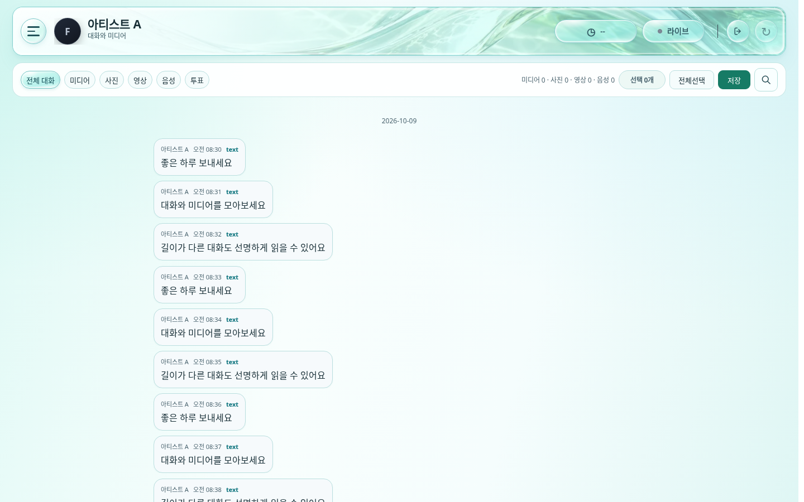 | 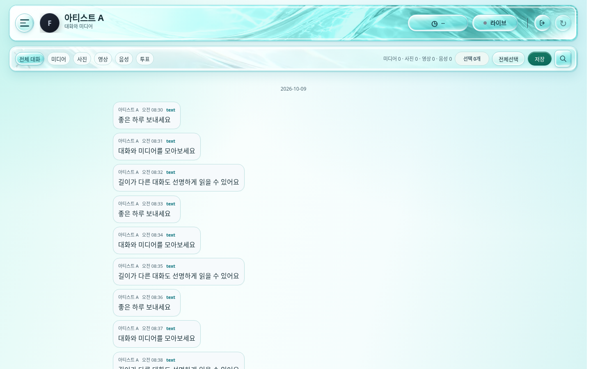 |

### 앱 3단 배치 모의 1440×900

| 수정 전 f52d48c | 수정 후 |
| --- | --- |
| 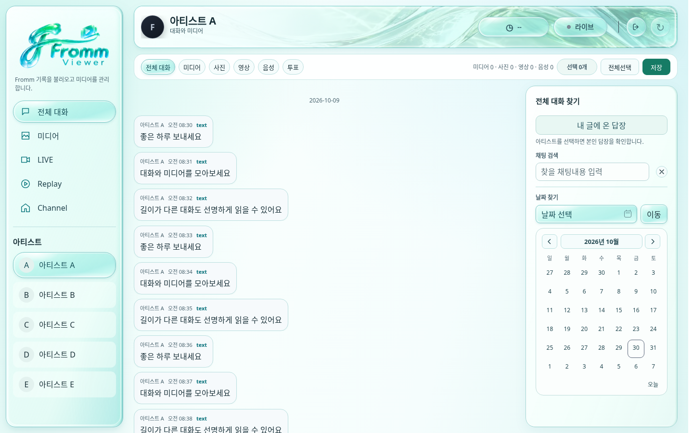 | 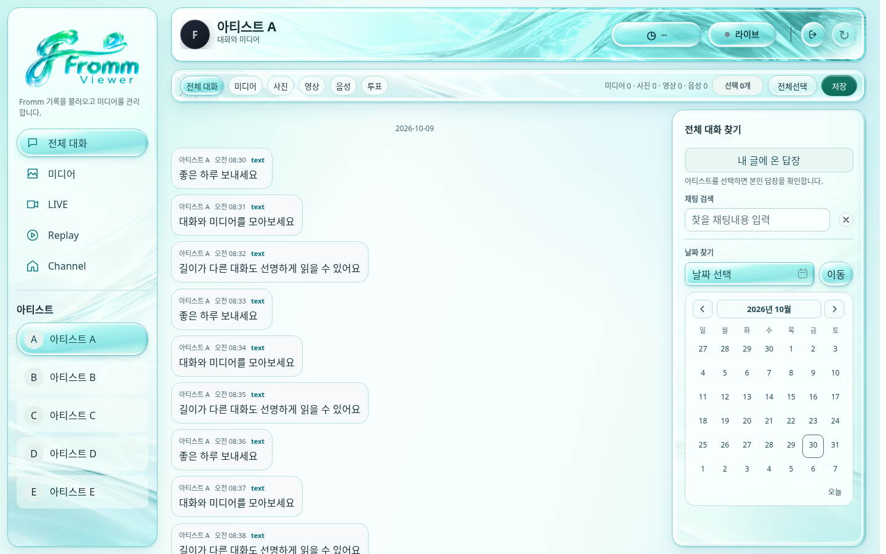 |

### 일반 웹 모바일 390×844

| 수정 전 f52d48c | 수정 후 |
| --- | --- |
| 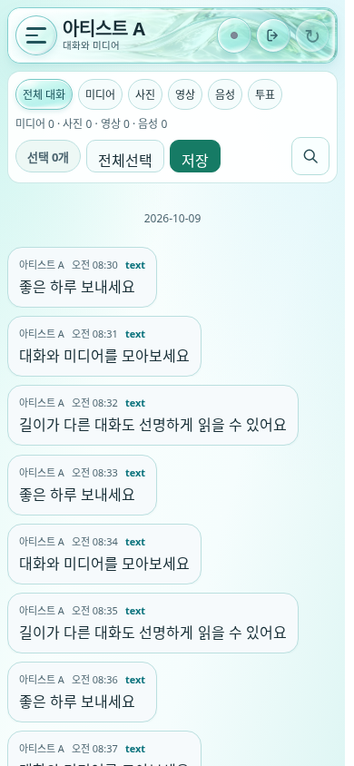 | 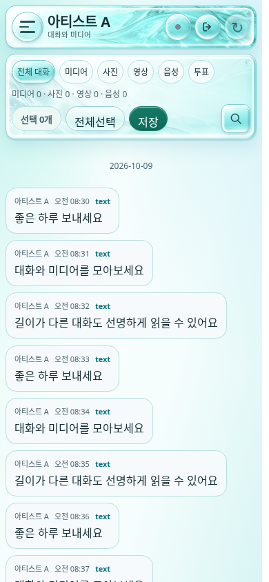 |

### Channel 가로 모바일 844×390

| 수정 전 f52d48c | 수정 후 |
| --- | --- |
| 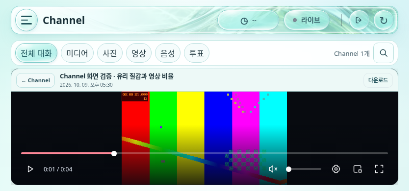 | 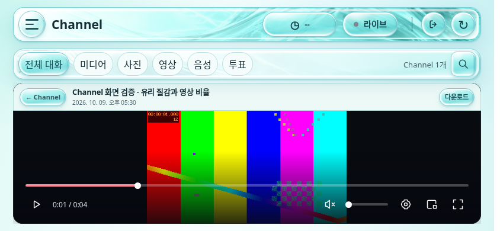 |

### Channel 헤더·탭 바 원본 확대

| 수정 전 f52d48c | 수정 후 |
| --- | --- |
| 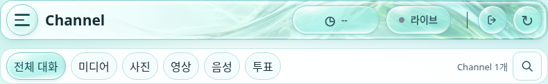 | 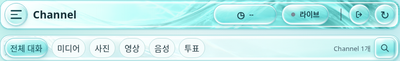 |

### 열린 메뉴의 선택 버튼 원본 확대

| 수정 전 f52d48c | 수정 후 |
| --- | --- |
| 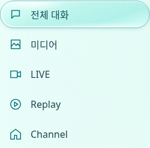 | 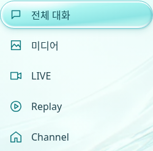 |

## 성능·가독성

동일 조건의 헤드리스 Chromium에서 각 버전/조건 3회 측정한 중앙값입니다. 다른 로컬 브라우저 검사를 동시에 실행하지 않았습니다. 실제 LIVE FPS·물리 모바일 GPU 측정이 아닙니다.

| 화면 | 중앙 프레임 간격 전→후 | P95 전→후 | JS heap 표본 전→후 |
| --- | --- | --- | --- |
| 웹 | 16.7→16.7ms | 16.8→16.7ms | 2.99→3.05MiB |
| 웹 양쪽 패널 | 16.7→16.7ms | 16.7→16.8ms | 3.29→3.37MiB |
| 앱 배치 모의 | 16.7→16.7ms | 16.7→16.8ms | 2.86→2.93MiB |
| 모바일 | 16.7→16.7ms | 16.8→16.7ms | 2.98→3.05MiB |
| 모바일 양쪽 패널 | 16.7→16.7ms | 16.7→16.7ms | 3.28→3.39MiB |

- 실제 합성 배경 픽셀을 샘플링한 가시 텍스트 최저 대비 **4.87:1**. 전체 서비스 접근성 인증은 아닙니다. 첫 3.77:1 헤더 LIVE 라벨은 진한 글자색으로 보완했습니다.
- 추가 장식 WebP **41,986 bytes / 1200×675**. 기존 헤더 포함 총 103,796 bytes, 최초 문서당 장식 1→2요청이며 패널별로 중복 다운로드하지 않습니다. 미디어/Fromm API 추가 요청 없음.
- 추가 이미지 디코딩 면은 RGBA 약 3.09MiB 추정입니다. JS heap은 GC에 영향을 받으며 이미지/GPU 메모리를 포함하지 않습니다. 전체 GPU/장기 메모리/배터리는 미측정입니다.
- 새 타이머·리렌더링 JS·Canvas/WebGL·실시간 왜곡·반복 광택 애니메이션 없음. 작은 버튼의 배경/테두리/그림자 전환만 기존 축소 모션 설정에 맞춰 처리합니다.
- [원본 측정 데이터](design-review/glowme-glass2/measurements.json). 전체 메뉴/오른쪽 패널 및 추가 뷰포트/비교 슬라이더는 최신 CI의 channel-browser-screenshots/liquid-glass artifact에 있습니다.

## 검증 및 남은 차이

- 로컬 Node 277/277 통과(실제 Agora 4.6.2 타입 포함, 스킵 0). Glow ME 웹320/390/844/1440·독립 패널·앱 넓은/좁은 창·PWA/SW·axe 통과.
- 고대비 모드에서 패널의 장식 이미지/그림자를 제거하고 시스템 색상으로 표시하는 검사 통과. 축소 모션/투명도 설정도 스타일에서 존중합니다.
- 광학 비교 6개 뷰포트/상태의 전후 12개 기본 화면, 웹/모바일 양쪽 패널, 가시 텍스트 대비, 장식 요청/대형 필터 한계 검사 통과. 실제 Channel 844×390 MP4 디코딩·contain·같은 영상 프레임/컨트롤/검정 면 경계 유지.
- 기존 전체 영상/선택/저장/LIVE 회귀는 최신 PR HEAD CI에서 확인합니다. 문서 작성 시 아직 실행 중이며 최종 상태는 PR #52 Checks와 설명을 우선합니다.
- 참고 시안보다 본문과 검색·달력 중심부를 조용하게 유지했습니다. 시안의 장식 기포 밀도·광선 굴절 형태를 그대로 복제하지 않았으며, 영상/본문을 가리지 않습니다.
- 광학 사진과 CSS를 합성한 정적 근사입니다. 뒤 픽셀을 물리적으로 굴절시키는 엔진이 아니며 실제 투명 유리와 같다고 주장하지 않습니다.
- 실제 Chrome 설치/업데이트·OS 창, 실인증 Fromm 스트림/LIVE·Native 연결, 물리 모바일/iOS/Safari, 실기 GPU 성능은 미검증입니다.
- 같은 feature/pwa-glowme / Draft PR #52만 갱신. main 병합·공개 배포·새 PR·도구/확장·Hooks 변경 없음.
