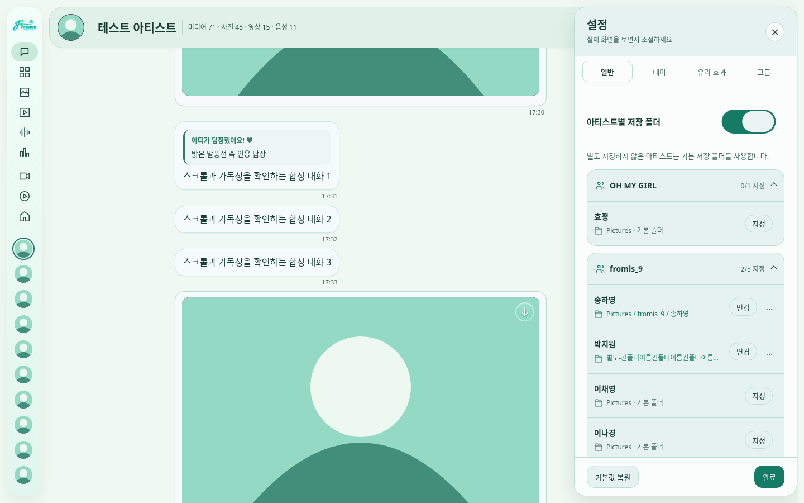
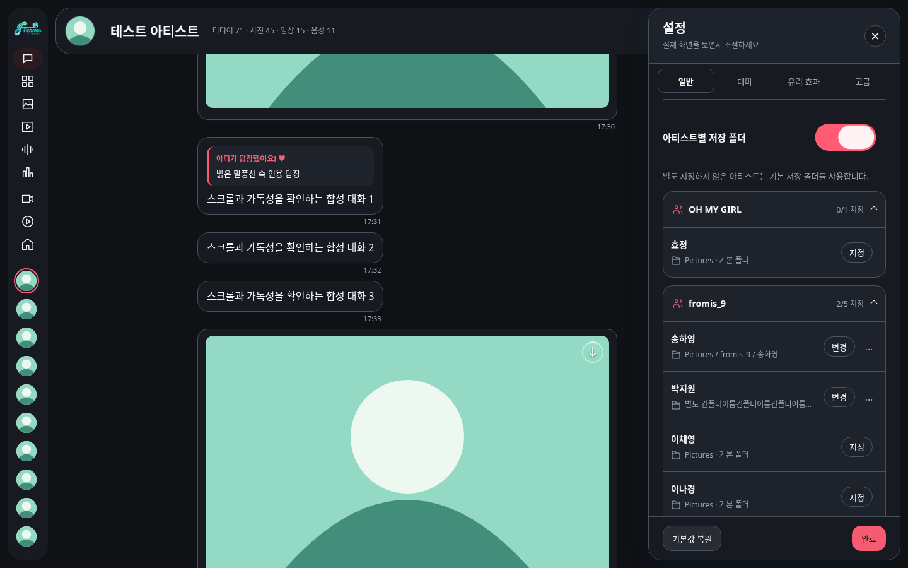

# 아티스트별 저장 폴더 설정과 유리 토글

2026-11-26 (한국 시간). 대상은 `fffdsaw/fromm-viewer`의 PC 설정 화면입니다. 기존 작업 브랜치 `codex/media-save-ui-header-20261125`를 main `f86ce9e`까지 이어서 작업했습니다.

사용자가 확인한 그룹 목록 시안과 `Fromm-Viewer-Toggle-Codex.zip`의 CODEX.md·demo.html·GIF를 기준으로 구현했습니다. 첨부 문서의 실험 저장소/별도 배포 승인 안내에는 이번 대화에서 지정한 본 저장소와 명시적인 병합·배포 요청을 우선했습니다. 토글의 이전 350ms 설명은 새 문서의 520ms 기준으로 대체했습니다.

## 적용 내용

- 기존 기본 폴더 선택·변경 기능을 유지합니다.
- 구독 목록을 소속 그룹으로 묶고 각 그룹 안에서는 기존 공개 생년월일 자료로 정렬합니다. 식별할 수 없는 아티스트는 기타 그룹에 표시합니다. 그룹별 펼침 상태를 계정별로 기억합니다.
- 실제 지정값을 집계해 `2/5 지정`처럼 표시합니다. 지정된 폴더는 테마 강조색과 변경 버튼·메뉴, 미지정은 기본 폴더 안내와 지정 버튼을 표시합니다.
- `…` 메뉴의 기본 폴더 사용은 개별 지정 연결만 해제합니다. 실제 파일은 유지합니다.
- 경로는 기본 폴더 핸들에서 실제로 확인한 하위 경로만 표시합니다. 기본 폴더 밖의 선택은 브라우저가 알려주는 폴더명만 표시하며, 임의의 절대 경로를 생성하지 않습니다. 긴 이름은 말줄임하고 마우스 제목 툴팁 또는 키보드 포커스로 전체 내용을 확인할 수 있습니다.
- OFF는 기본 폴더로 저장합니다. 개별 폴더 핸들은 보존되고 ON에서 다시 사용합니다. 토글 값은 계정별로 저장하며, 기존 사용자에게는 기존 라우팅과 같은 ON을 기본으로 합니다. 목록 등장·퇴장은 200ms입니다.

## 첨부 토글 구현

트랙은 논리 비율 124:55, 실제 약 97×43px이며 밝은 손잡이는 약 57×37px입니다. 전환 여백을 포함한 버튼은 128×75px입니다. 첨부 예제의 키프레임과 520ms 전환을 사용하며, 대표 프레임은 논리 크기 115×73, 오프셋 +13, 중심 -2를 그대로 따릅니다. GIF의 비교용 정지 구간은 재생에 추가하지 않았습니다.

기존 Meapri 엔진과 설정은 유지합니다. 이 토글의 전환 중 바 윤곽에는 첨부에서 허용한 로컬 Canvas 샘플링을 적용합니다. Canvas는 해당 바의 픽셀만 다시 샘플링하며, 전역 광학 엔진이나 다른 토글을 교체하지 않습니다. 현재 테마 토큰으로 트랙·밝은 손잡이·하이라이트를 연결했고, 초기 DOM 연결 후에도 실제 테마를 다시 읽습니다. 빠르게 방향을 바꿔도 현재 진행 위치에서 반전합니다.

기본 button의 Space·Enter 조작, `role="switch"`, `aria-checked`, 포커스 표시를 사용합니다. 동작 감소·투명도 감소·강제 색상·유리 효과 비활성 상태에서는 최종 상태를 바로 적용합니다. Canvas를 사용할 수 없으면 CSS 기본 토글이 상태를 표시합니다. 설정창을 닫거나 숨기면 진행 중 애니메이션을 정리하며, 컴포넌트에는 destroy API가 있습니다.

## 검증

Node.js 24.22.3, Playwright 1.62.1, Chromium 151.0.7922.34의 full Chromium에서 합성 구독·미디어와 별도 OPFS를 사용했습니다. 실제 계정이나 사용자의 OS 폴더는 사용하지 않았습니다.

- 웹·Native 단위 테스트 337 통과, 기존 Agora 관련 1개 건너뜀.
- 새 `artist-folder-settings` 브라우저 검증: 그룹·생년월일·실제 개수, 확인된 하위 경로와 긴 외부 폴더명, 키보드로 전체 경로 확인, 초기 테마 및 테마 변경의 실제 Canvas RGB, 전환 시 높이 팽창, 연속 클릭과 위치 연속성, Space·Enter, OFF 기본 폴더/ON 개별 폴더에 기존 저장 파이프라인으로 실제 쓰기, OFF 재접속 복원과 핸들 유지, 그룹 기억, 지정 해제 시 파일 유지, 계정 격리, 동작 감소 및 모바일 제외를 검증합니다.
- 기존 `artist-save-folders`, `settings-themes`, `glass-settings`, `media-bulk-save-folder`, `selection-save-ui` 브라우저 검증 통과. 파일명·중복·권한 거부·취소·부분 실패·사진/영상 루트와 기존 소문자 `audio/` 하위 폴더를 유지합니다.
- 새 검증은 Conversation의 Chromium·Chrome·Edge CI에 포함하고, 배포 검증에 새 모듈 해시를 추가했습니다. 최종 원격 검사와 배포 결과는 PR에 기록합니다.

파일 쓰기·변환·중복 검사 함수는 변경하지 않았습니다. `web-save-folder.js` 변경은 계정별 활성화 값과 경로 설명, 활성화 값에 따른 기존 폴더 선택에 한정됩니다. 실제 OS 선택 창의 표시 방식, 서비스 로그인, 물리 기기/GPU, 브라우저가 제공하지 않는 절대 경로는 검증 범위 밖입니다. 이번 기능은 PC에 적용하며 모바일 설정 동작은 유지합니다.

## 변경 파일

설정 UI: `web-glass-settings.js`, `settings-panel.css`. 토글: `web-artist-folder-switch.js`. 폴더 설정 연결: `web-save-folder.js`. 그룹 조회: `web-artists.js`. 동일 모듈 인스턴스 및 캐시 갱신용 URL: `index.html`, `web-glass.js`, `web-glass-controls.js`, `web-clear-controls.js`, `web-morph-menu.js`, `web-capsule-materialize.js`. 검증: `test/artist-folder-settings.browser.cjs`, `test/artist-save-folders.browser.cjs`, `test/helpers/shell-assets.cjs`, 관련 CI/배포 검증 workflow. 보고: `CODEX_HANDOFF.md`와 이 디렉터리.

## 실제 화면과 토글 기록

GIF는 첨부 원본이 아니라 구현된 웹 컴포넌트를 실제 클릭하고 매 프레임 Canvas를 기록한 것입니다.

