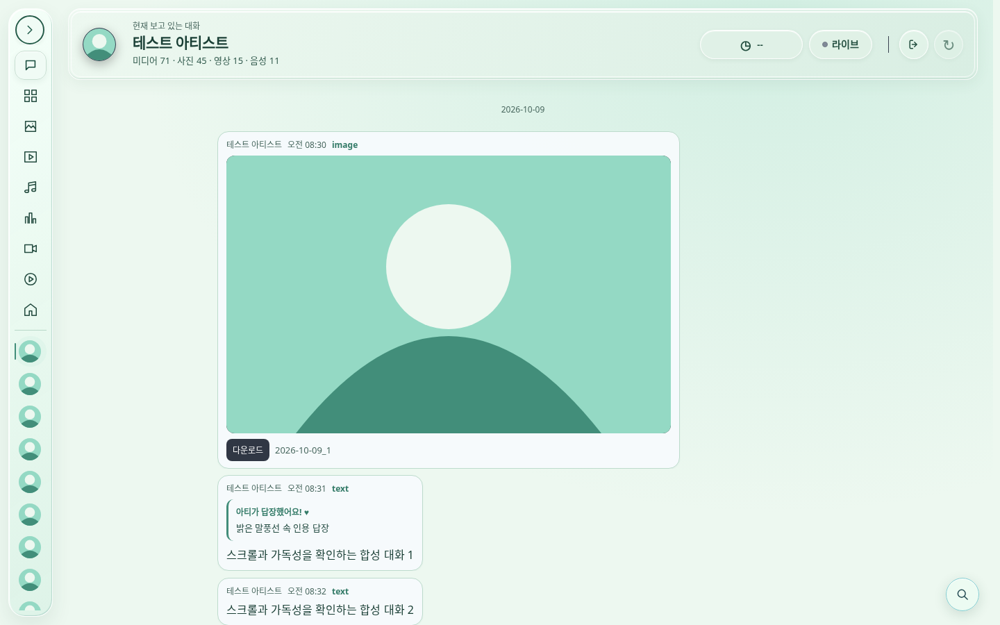
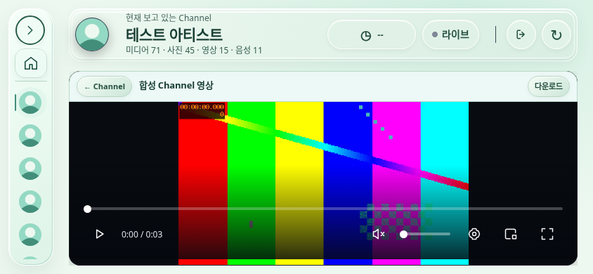

# Glow ME 3차 — 4차 통합 검증 기록

**Meapri Regular는 소형 컨트롤의 제한적 시험 적용이다. 엔진 최종 본격 적용 및 시각 마감은 별도 미완료 작업이다. 이 보고서의 구현·검증 완료와 구분한다.**

- 브랜치: `feature/glowme-uiux-phase3`, [Draft PR #53](https://github.com/fffdsaw/fromm-viewer/pull/53)
- 기준 main: `552bc556d8eaacbcc589cb9bfabab6383b9d4dba`. PR #50/#51 미병합. main·공개 사이트·Hooks·Native·확장프로그램 코어 미변경.
- 실제 로컬 HTTP를 Chromium에서 실행했다. 화면의 아티스트·대화·프로필·영상은 모두 합성 자료이며 실제 서비스 데이터가 아니다.

## 완료한 구현과 검증 범위

P1 인용문 대비/로그인 초점 → 1차 플로팅 9개 메뉴·독립 아티스트 스크롤·현재 아티스트 헤더 → 2차 검색/날짜/필터 위치 복원·조건부 선택 도구 → 3차 미니멀 민트 표면/Meapri 시험 적용 → 4차 회귀·실제 화면·성능·독립 평가에 따른 결함 수정을 진행했다.

4차에서 실제 고친 결함:

| 문제 | 원인 및 수정 | 확인 |
|---|---|---|
| 아티스트 사진 대신 대체 아이콘 | lazy 이미지가 DOM 밖에 있어 요청되지 않음. 실제 아바타 컨테이너에 삽입, 실패 시만 대체 아이콘 | naturalWidth 및 실제 PNG |
| 선택할 때 카드 위치 이동 | 정렬바까지 일괄 도구와 함께 fixed로 바뀜. 일괄 버튼만 별도 오버레이 | 카드 좌표 불변, 드래그/해제/자동 스크롤 |
| 날짜 이동 후 날짜가 위로 밀림 | content-visibility가 여러 프레임 뒤 행 높이를 갱신. 최대12프레임 보정, 사용자 입력/새 이동 시 취소 | 3000개 합성 대화, 1440/390, 짧은 화면 |
| 모바일 검색이 레일을 가림 | 패널 폭이 화면 전체를 기준으로 함. 레일 공간을 제외한 폭으로 제한 | 320/390 실제 클릭/기하 |
| PWA/가로 검색 화살표 가림 | 고정 검색 패널 뒤에 기존 플로팅 버튼이 위치. 열리면 패널 내부, 닫히면 플로팅 복귀 | 실제 이전/다음 클릭, 문맥/필터 유지 |
| 기록 중단 안내를 볼 수 없음 | 중복 통계 제거 시 원래 상태 안내도 시각적으로 숨김. 오류/로딩 상태만 헤더에 별도 표시 | 오류/재시도 안내 노출 |
| 가로에서 달력을 열어도 날짜가 보이지 않음 | 낮은 패널 아래로 달력 추가. 필요한 경우 패널 내부만 스크롤 | 첫 선택 가능 날짜가 패널 안에 표시 |
| 빈 상태/파일 없음 글자 대비 부족 | 이전 다크 테마 회색 잔존. #48675e 적용 | 보수적 #d2e6dc 배경 대비 **4.76:1** |
| 축소 레일 아이콘 중복 | 미디어/사진 및 영상/LIVE 같은 도형. 구분되는 9개 SVG로 교체 | 실제 화면 및 경로 구분 |
| 모바일 설정 메뉴가 재생 버튼을 가림 | 두 줄 컨트롤의 두 번째 줄을 기준으로 팝업을 배치. 컨트롤 전체 위에 배치하고 높이가 부족하면 메뉴 내부 스크롤 | Replay/Channel 390px 실제 클릭, 전체 뷰포트 조작 회귀 |

## 독립 Impeccable 평가

Method: dual-agent (A: `/root/phase3_final_design_a` · B: `/root/phase3_final_evidence_b`). 이전 한도 중단 시 저장된 증거를 재사용해 각 평가자가 보고서를 완성했다. 서로의 결과를 보지 않고 평가했다.

- [A 독립 디자인 평가](critique-a.md): 수정 전 **26/40**. 검색 이동 가림/기록 중단 안내(P1), 가로 달력/아이콘(P2). 이 점수를 수정 후 재평가 점수로 주장하지 않는다.
- [B 검사·브라우저 증거](critique-b.md): CLI **36건**(대비25/이미지2/작은 글자3/pulse1/marquee4/glow1)을 재사용. 외부 CSS와 런타임 상태를 반영하지 못하는 경고 및 원래 필요한 동작도 포함한다. 36개 미해결 결함을 뜻하지 않는다.
- 공통: 축소 레일의 아이콘 구분. A만 확인한 주요 항목: 검색 이동·기록 상태·가로 달력. B가 구체적 수치로 확인한 항목: 빈 상태 2.0:1/파일 없음 2.3:1의 대비. 위 수정 표에서 해결했다.
- 실제 HTTP overlay 주입은 로그인/대화/모바일 검색 모두 성공. axe 확정 위반은 관찰한 화면에서 0이었으나 대비 판정 incomplete가 있으므로 전체 WCAG 준수 판정으로 사용하지 않는다. 수정 후 대상 대비와 실제 접근 경로를 별도 회귀 검사했다.
- 사용자에게 보이는 [Human] 브라우저는 제공되지 않았다. Headless Playwright 화면/스크린샷으로 확인했으며 검사 서버·브라우저·임시 주입 파일은 정리했다. Hooks를 활성화하지 않았다.

## 같은 크기·같은 자료의 전후 실제 화면

원본 PNG 링크를 열면 전체 해상도로 볼 수 있다. 설치 앱은 `display-mode: standalone` **배치 모의**이며 OS에 실제 설치한 검사가 아니다.

| 화면 | 기준 main | 현재 구현 |
|---|---|---|
| 웹 1440×900 | [이전](before-1440x900-chat.png) | [이후](after-1440x900-chat.png) |
| 웹 메뉴 1440×900 | [이전](before-1440x900-menu.png) | [이후](after-1440x900-menu.png) |
| 모바일 메뉴 390×844 | [이전](before-390x844-menu.png) | [이후](after-390x844-menu.png) |
| 모바일 검색 390×844 | [이전](before-390x844-search.png) | [이후](after-390x844-search.png) |
| Channel 844×390 | [이전](before-844x390-channel.png) | [이후](after-844x390-channel.png) |
| PWA 배치 모의 1440×900 | [이전](before-1440x900-pwa-chat.png) | [이후](after-1440x900-pwa-chat.png) |

## Meapri와 시각적 차이

[고정 upstream에서 직접 빌드한 Regular 데모](meapri-regular-reference.png)와 실제 앱을 비교했다. 데모는 큰 색면과 움직이는 배경으로 렌즈 효과를 강조한다. 앱은 사용자 최신 요구에 맞춰 물결 이미지를 제거하고 읽기 표면을 조용하게 유지했다. 따라서 데모와 같은 강한 굴절 외관을 구현했다고 주장하지 않는다.

현재 시험 범위는 레일 토글/현재 메뉴/검색/헤더의 작은 조작 버튼(최대5개)이다. 실제 Chromium computed backdrop-filter의 SVG URL을 확인했다. 전체 헤더·대화·영상·대량 미디어 카드에는 엔진을 적용하지 않는다. 화면 밖/숨김 문서/감소 모션·투명도/고대비/저사양 조건에서는 효과를 중단한다. IntersectionObserver가 없는 환경에서도 정적 대체 표현으로 전환한다. Safari-UA 대체 경로는 Chromium에서 분기만 확인했으며 Safari 실기 검증이 아니다.

원본 MIT LICENSE, 고정 소스 SHA, 정적 번들 및 빌드 기록은 [vendor/meapri](../../../vendor/meapri/README.md)에 있다. 색수차0, 작은 렌즈, 제한된 반사광으로 시작한 시험 값이며 최종 시각 마감 값은 아니다. 날짜 버튼 등 일부 기존 장식의 재질 일관성도 후속 시각 마감에서 다룬다.

## 동일 조건 성능 비교

Linux Headless Chromium, 동일 합성180메시지/30아티스트, 각각3회 순차 실행한 중앙값. 다른 로컬 브라우저 작업을 종료하고 측정했다. 원자료: [performance.json](performance.json).

| 측정 | 기준 main | 현재 시험 적용 | 현재 UI·굴절 끔 |
|---|---:|---:|---:|
| 화면+합성 데이터 준비 | 765 ms | 731 ms | 869 ms |
| 스크롤 rAF 중앙값 | 16.7 ms | 16.7 ms | 16.7 ms |
| 스크롤 rAF p95 | 33.3 ms | 16.8 ms | 16.8 ms |
| 90프레임 중 JS TaskDuration | 351.53 ms | 393.21 ms | 306.92 ms |
| JS 힙 사용량 | 2.43 MiB | 2.97 MiB | 2.7 MiB |
| 메뉴 열림 안정화 | 249 ms | 233 ms | 233 ms |

초기 준비 차이는 작고 환경 변동이 있으므로 속도 향상을 단정하지 않는다. 현재 UI의 프레임 간격은 약16.7ms를 유지했지만 굴절 효과에는 추가 스크립트·힙 비용이 있다. 화면 밖 헤더 렌즈를 해제하여 불필요한 효과 수명을 제한했다. JS 힙은 프로세스/GPU 전체 메모리가 아니며 TaskDuration은 CPU 점유율이 아니다. 물리 모바일의 발열/배터리/GPU 품질은 아직 검증하지 않았다.

## 테스트와 재현

- Node: `node --test test/*.test.cjs native-live/test/*.test.cjs` — **277 중276 통과, 실패0, skip1**(로컬 Agora SDK 타입 미설치).
- 새 검사: `glowme-phase3-a11y`, `glowme-phase3`, `glowme-phase3-navigation`, `glowme-phase3-review`, `glowme-phase3-visual`의 `.browser.cjs`. 로그인 초점/대비, 320·390·844×390·1440/PWA, 휠 경계/레일/프로필, 날짜·선택·검색, 최종 결함, 전후 화면/성능을 확인한다.
- 기존 회귀: PWA/공개 이미지 캐시, 아이콘, 자동 추가 로딩, Channel/Replay 로컬 MP4, 화질 최고값/수동 전환/다운로드 독립성, 선택 제스처, 중복 저장·파일명, 배경 로딩, LIVE UI/PiP·진단·댓글, 투표 원본 저장, 답장·3000개 문맥 이동, 확장 TLS/POST/ACK/CORS 합성 통신.
- 플레이어 조작: 1440/390/844에서 설정 닫기와 재생 상태 유지, 회전/전체 화면/키보드/재생바 fade/터치 유지 및 정리 통과. Channel12/Replay13 뷰포트 기존 검사와 최종844×390 캡처를 사용한다.
- [코어 동일성 확인](core-integrity.json): 인증·HLS·화질·저장 핵심 함수16개 동일. Native/확장/LIVE 연결 코어 파일 미변경. UI 표시·위치/날짜 보정만 연결했다.
- CI의 과거 `independent top and middle panels`는 제거된 중복 탭 바를 전제로 한 구형 조건이었다. 최신 실제 레일/PWA/접근성 검사를 유지하며 대체했다. 후속 레일 폭 검사 실패는 200ms 닫힘 전환 도중 측정한 경쟁 상태로, 실제 축소 완료를 기다리도록 수정했다. 2be3ead의 모바일 설정 팝업 실패는 실제 UI 결함으로 수정했다. 재생바 fade 검사는 초기 미디어 이벤트 중 강제 class 변경/80ms 고정 대기 대신 실제 자동 숨김의 중간 프레임과 visibility를 확인한다. 터치 유지·해제·감소 모션 검증도 유지한다.
- 최종 CI 결과와 구현 SHA는 인계 문서 및 동일 Draft PR에서 확인한다. 문서만 갱신된 마지막 SHA와 검증한 구현 SHA를 구분한다.

## 미검증 및 남은 작업

- 실제 Fromm 인증 스트림·실방송, Windows Native LIVE 실제 수신/패키지, 물리 모바일/iOS, Windows Chrome/Edge 및 macOS Chrome/Safari 실기.
- OS 설치형 PWA의 실제 설치/업데이트, 실제 GPU/전체 프로세스 메모리·발열·배터리, 보조공학 실기/모든 브라우저 확대 조합.
- **Meapri Regular의 본격 적용 범위와 최종 시각 마감은 별도 작업**. 실제 콘텐츠와 물리 저사양 기기에서 비용을 보고 강도를 결정해야 한다.
- main 병합·공개 배포는 수행하지 않았다. PR #50/#51의 겹치는 접근성/CSS는 향후 병합 때 수동 대조가 필요하다.

## 최종 CI 확인

검증한 구현·검사 커밋은 `a88b0711a48713d7be7a387352d688716e817209`이다.

- [Channel/UI 전체 CI](https://github.com/fffdsaw/fromm-viewer/actions/runs/42073136663): Node 및 browser **SUCCESS**.
- [Media bulk save CI](https://github.com/fffdsaw/fromm-viewer/actions/runs/42073137082): Node 및 browser **SUCCESS**.
- 이후 최종 기록 커밋은 Markdown 두 파일만 변경하며 앱/검사 코드가 동일하므로 CI를 반복하지 않는다. 과거 실패는 모두 수정되어 위 전체 검사에서 통과했다. Meapri 본격 적용·시각 마감 및 명시된 실기 검증은 여전히 별도 미완료이다.
