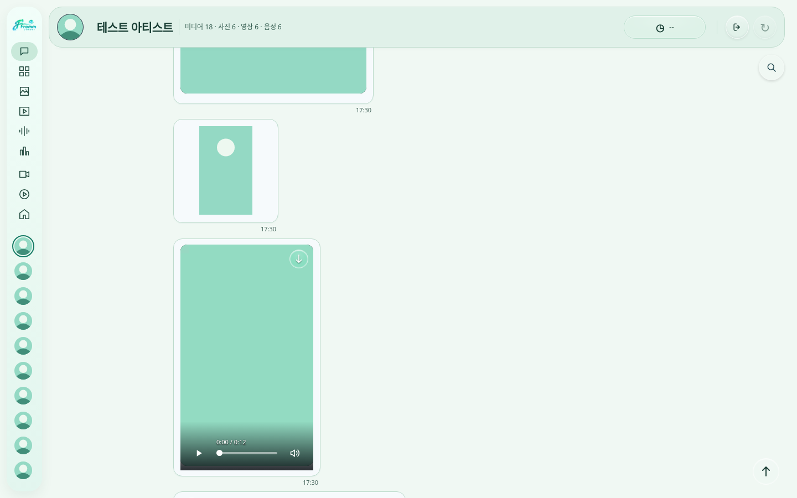
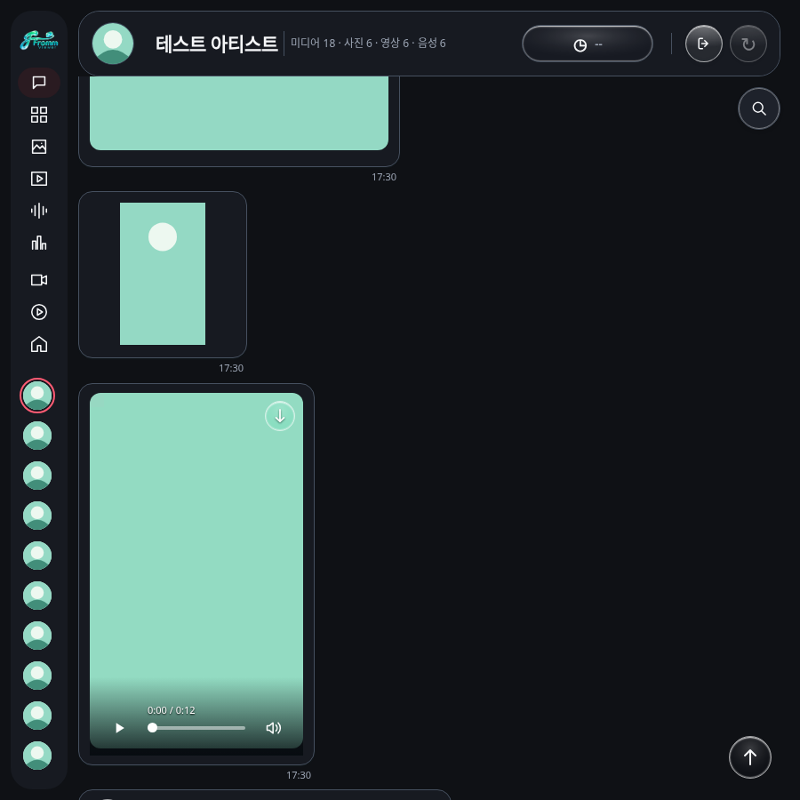
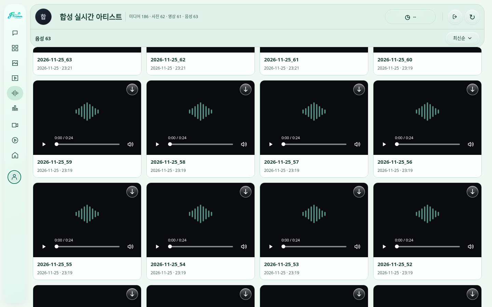

# PC 전체 대화 스크롤과 실시간 미디어 갱신

2026-11-25. `fffdsaw/fromm-viewer`, `codex/media-save-ui-header-20261125`, 기준 main `7347f48`.

## 원인과 수정

전체 대화의 모든 메시지에 `content-visibility:auto`와 임시 높이 80px가 적용돼 있었습니다. 사진뿐 아니라 이모티콘·영상·음성 카드도 스크롤 중 실제 높이로 바뀔 수 있었습니다. 기존 보정은 사진을 앞에 추가한 뒤 최대 12초 동안만 작동했고, 사용자 휠 입력으로 끝났습니다. 카드 자체의 높이가 달라질 때는 카드의 위쪽만 고정해도 아래 대화가 밀렸습니다.

PC에서는 네 종류의 카드에 실제 레이아웃을 유지합니다. 겹치는 메시지 창을 다시 그릴 때 기존 미디어 DOM을 문서에서 분리하지 않고 재사용합니다. `ResizeObserver`가 현재 읽는 위치를 계속 추적하며 문서 내 위치의 변화만 보정합니다. 사용자가 스크롤하면 추적 기준도 함께 바뀝니다. 일부가 보이는 카드의 아래쪽이 화면에 있으면 그 아래쪽을 기준으로 삼습니다. 검색·인용·최신 이동·기록 복원은 기존 위치 제어를 우선합니다. 사진의 기존 한정된 크기/HTTP URL 캐시와 해제 처리는 유지합니다.

미디어·사진·영상·음성 탭으로 이동할 때 기존 수신기가 중지되는 것이 자동 갱신이 안 되는 직접 원인이었습니다. PC의 네 탭에서도 동일한 수신기 하나를 유지합니다. 기존 Firebase 알림을 받으면 기존 증분 REST 조회를 실행하고, 연결이 없으면 기존 약 3초 주기 조회를 사용합니다. 재시도 대기와 429 제한을 그대로 따릅니다. 탭을 바꾸면 한 번 즉시 확인합니다. 새 미디어는 기존 카드 사이에 추가하고, 보고 있던 위치와 재생 중인 요소를 유지합니다. 텍스트만 수신했을 때는 미디어 DOM을 늘리지 않습니다. 목록과 상단 미디어 통계도 함께 갱신합니다.

## 변경 파일

- `index.html`: 카드 종류 표시, 미디어 DOM 재사용, 실시간 갤러리 갱신, 변경 자산 버전.
- `web-view-state.js`: 모든 미디어의 현재 읽기 위치 추적과 카드 재사용.
- `conversation.css`: PC 미디어 카드의 임시 높이 생략 방지.
- `web-conversation.js`: PC 갤러리 수신 유지와 목록/통계 갱신.
- `test/conversation-rich-media-live.browser.cjs`, `test/fixtures/rich-card.mp4`: 합성 지연 로딩·실시간 수신 회귀 검증과 3.6KB 단색 영상.
- `test/conversation.browser.cjs`, `test/conversation-refresh-cache.browser.cjs`, `test/desktop-member-latest.browser.cjs`, `.github/workflows/conversation.yml`: PC 수신 유지와 기존 터치 수명주기를 각각 검증하고 새 검증을 브라우저 3종 CI에 포함.
- `CODEX_HANDOFF.md`, 이 보고서와 PNG 3개: 작업 및 검증 기록.

## 로컬 검증

Node.js 24.22.3, Playwright 1.62.1, Chromium 151.0.7922.34. 별도 브라우저 컨텍스트의 합성 계정·SVG·실제 디코딩 가능한 MP4/WAV·실제 IndexedDB만 사용했습니다.

| 항목 | 결과 |
| --- | --- |
| 1440px 밝은 테마, 900px 어두운 테마, 실제 휠로 과거 메시지 추가 | 통과 |
| 사용자 스크롤 뒤 사진·이모티콘·영상·음성 응답 지연 | 레이아웃 보정 후 읽기 위치 변화 최대 0.000 CSS px |
| 기존 12초 제한을 넘긴 12.5초 응답 지연 | 통과 |
| 겹치는 메시지 창 및 전체 재렌더 | 기존 영상·음성·이모티콘 DOM 동일, 영상/음성 재생 중단 0회 |
| 미디어/사진/영상/음성 탭, 새로고침 없이 푸시 알림 후 표시 | 각각 141/198/151/161ms, 합성 응답 환경 측정 |
| 푸시 연결 해제 후 새 음성 | 기존 REST 주기로 3310ms 후 표시 |
| 목록 중간에서 새 음성 수신 | 읽기 위치 유지, 실제 음성 재생 유지 |
| 일반 텍스트 수신 | 미디어 카드 개수 유지 |
| 상단 통계 | 실제 수신 건수와 일치 |
| 전체 캐시 유지 | 187개 ID 중복 없음, complete 유지, 과거 기록 재조회 0회 |
| 다른 탭으로 이동 | 미디어 수신 중지 |
| 웹·Native 단위 테스트 | 337 통과, 기존 Agora 관련 1개 건너뜀 |
| 50,000개 대화 | 캐시 50,000개 유지, 처음 표시 DOM 241개, 전체 캐시 과거 재조회 0회 |

기존 사진 복구/비율/객체 URL 해제, 기록의 점진적 표시와 캐시 복원, 수신·전송, 계정 격리, 충돌 격리, 저장 중단 복구, 이모티콘, 음성 제어, 검색·달력·인용, 맨 위/최신 이동, 저장 버튼의 실제 쓰기·진행률·중복 건너뛰기 검증도 통과했습니다. 최신 이동의 간헐적인 방향 역전도 CI에서 재현됐습니다. 첫 프레임의 음수 진행값을 막고, 레이아웃이 줄어 목표 위치가 가까워져도 PC 최신 이동이 역방향으로 돌아가지 않도록 보완했습니다. 실제 화면 밖 메시지 높이를 줄이는 회귀 테스트는 수정 전 실패했고 수정 후 통과했습니다. 전체 Chromium으로 3회, headless shell로 1회 연속 통과했으며, 기존 맨 위 이동·수동 취소·동작 감소 설정도 통과했습니다. 원격 Chrome/Edge/Chromium CI 결과는 PR의 필수 검사에서 확인합니다.

첫 원격 검사에서는 탭 복귀 직후 위치 복원 중 약 12.2px 차이가 재현됐습니다. 복원 담당 코드가 다음 프레임까지 보정을 미루던 경로도 PC 미디어에서는 화면을 그리기 전에 보정하고, 카드 아래쪽을 같은 기준으로 사용하도록 수정했습니다. 기존 검증의 기준을 바꾸지 않고 탭 복귀 오차 약 0.22px로 통과했습니다. 900px 혼합 미디어 테스트에는 복원 중 지연 응답도 추가했으며 최대 변화 0.000px로 통과했습니다.

## 스크린샷

실제 사용자 대화가 아닌 합성 카드입니다.

## 보존 범위와 제한

파일 쓰기·폴더 권한·기본 및 아티스트별 저장 경로·파일명·확장자·중복 검사·변환·저장 결과 패널을 변경하지 않았습니다. 사진과 영상은 기존 지정 루트, 음성은 기존 소스의 정확한 소문자 `audio/` 하위 폴더를 유지합니다. 대화 캐시와 충돌 후보 저장 규칙, 기존 Liquid Glass 엔진·설정·메뉴 모션은 유지합니다. 모바일은 개선 대상에서 제외했고 기존 동작의 회귀만 확인했습니다.

실제 로그인 계정의 실시간 서버 응답, 사용자의 OS 폴더, 특정 기기/GPU에서의 장시간 사용은 검증하지 않았습니다. 합성 수신 시간은 실제 서비스 지연을 보장하지 않습니다. 권한 거부·네트워크 오류·서버 제한은 기존 중단/재시도 기준을 따릅니다.

재현: `NODE_PATH=<Playwright 설치 경로> CONVERSATION_DIR=<출력 경로> node test/conversation-rich-media-live.browser.cjs`.
