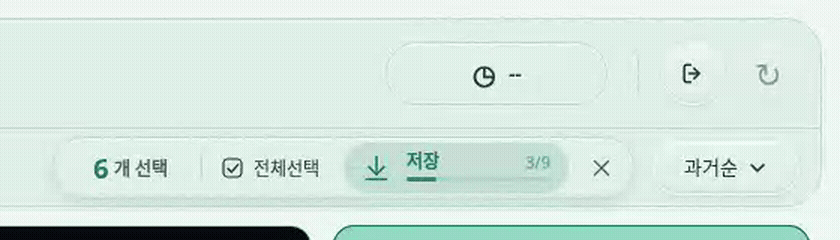

# PC 미디어 선택 작업 바와 공통 헤더

대상: `fffdsaw/fromm-viewer`, `main`의 `c29f6aa` 기준 작업 브랜치 `codex/media-save-ui-header-20261125`. 사용자의 후속 요청에 따라 모바일 개선은 제외했다. 모바일 기존 스타일과 저장 흐름을 보존한다. 사용자 요청에는 검수 후 병합·운영 배포 승인이 포함되어 있다.

## 변경 결과

기존 선택 캡슐 하나를 유지하고 숫자 강조, 구분선, 체크박스 아이콘, 민트색 저장 배경, 간결한 X 버튼을 적용했다. 저장 버튼과 아이콘의 위치·크기는 세 상태에서 고정된다. 기존 광학 엔진, 설정, Morph 메뉴 및 플로팅 알림은 교체하지 않았다.

텍스트는 230ms 동안 왼쪽 위로 이동한다. 같은 행의 진행 숫자는 90ms 지연 후 200ms, 그 아래 2.5px 진행 바는 110ms 지연 후 180ms 동안 등장한다. 숫자는 tabular-nums를 사용한다. 실제 완료 후 바가 채워지는 220ms를 확보하고, 240ms 동안 체크 모양과 가운데 `저장 완료`로 전환한다. 완료 표시는 기존 완료 처리의 1,100ms 구간에 들어간다. CSS `d` 보간을 지원하지 않는 브라우저에는 체크 경로의 교차 페이드를 제공한다. 동작 감소 설정에서는 이동·보간과 완료 대기를 생략한다. 이 시간들은 표시 전용이며 저장 및 결과 패널을 지연하지 않는다.

기존 코드가 버튼의 텍스트를 교체해도 애니메이션 노드가 사라지지 않도록 장식 콘텐츠를 동일한 버튼 경계 안에 겹친다. 장식은 접근성 트리에서 숨기고 기존 네이티브 버튼과 핸들러를 유지한다. 저장 시작 시 선택 키를 고정하고, 실제 쓰기 완료 또는 기존 파일 확인 지점의 선택 확인 콜백을 한 번씩 집계한다. 네트워크 수신 시작이나 임의 타이머로 진행 건수를 늘리지 않는다. 브라우저 다운로드 방식은 기존대로 `요청 완료`로 구분하며 부분 실패에 정상 완료 표시를 하지 않는다.

상단 우측은 실제 미디어 탭에서 측정한 148×42px 시간 캡슐, 42px 버튼, 20px 아이콘, 6px 그룹 간격, 16px 구분선 안쪽 여백, 14px 헤더 끝 여백을 공통 CSS로 적용했다. 1440·900·760·701px에서 기존 미디어 헤더 좌표가 기준 버전과 동일했다. 같은 해상도·확대율에서 채팅·미디어·사진·영상·음성·투표·Channel·Replay·LIVE의 좌표와 크기가 일치했다. LIVE의 기존 60px 헤더도 미디어 기준 72px 공통 높이를 사용한다. 좁은 PC Artist 목록은 멤버 필터가 표시될 때 선택 행을 미리 확보해 필터와 저장 UI가 겹치지 않는다.

## 변경 파일

- `index.html`: UI 진행/완료 콜백과 UI 자산 캐시 키
- `web-glowme.js`: PC 표시 상태, 고정 장식 콘텐츠, 선택 개수 강조
- `glowme-controls.css`: PC 선택 바·전환 애니메이션·공통 헤더
- `.github/workflows/media-bulk-save.yml`: 새 브라우저 회귀 검증 실행
- `test/selection-save-ui.browser.cjs`: 실제 쓰기와 UI 상태 회귀 검증
- `test/capsule-materialize.browser.cjs`, `test/capsule-states.browser.cjs`, `test/channel-photos.browser.cjs`, `test/collection-header.browser.cjs`, `test/direct-selection.browser.cjs`, `test/video-download-engine.browser.cjs`, `test/pc-layout.browser.cjs`: 변경된 PC 디자인 기대값 갱신
- `CODEX_HANDOFF.md`, 이 보고서 및 같은 폴더의 PNG/GIF: 검증 기록과 시각 자료

## 저장 방식과 폴더 조사

파일 선택·권한 유지·기본 폴더·파일명·확장자·중복 검사·변환·일괄 저장·실제 쓰기는 변경하지 않았다. `index.html`에는 표시 상태를 받는 선택적 콜백과 변경된 UI 자산의 캐시 키만 추가했다. `web-save-folder.js`, `web-video-download.js`, `web-channel-photos.js`, 저장/결과 알림 함수와 광학 엔진 파일은 변경하지 않았다.

요청의 `Audio`와 달리 현재 코드의 정확한 경로는 **소문자 `audio`**다. `git blame`은 이 `mediaFolder()` 규칙을 `14a8b53`(2026-10-08, v61 업로드)으로 추적하며, 현재 `main`까지 유지되어 있다. 확인한 전체 브랜치 이력의 `return "Audio"` 검색에서도 대문자 규칙 변경을 찾지 못했다. 최근 작업에서 경로가 바뀌었다는 증거는 없으며 이번에는 대소문자를 바꾸지 않았다. 사진·영상은 선택 폴더 바로 아래, 음성은 기존 `audio/` 아래로 쓰는 것을 합성 파일로 확인했다. 멤버별 별도 경로 설정의 존재나 실제 사용자 폴더는 이번에 확인하지 않았다.

## 스크린샷과 영상

모두 합성 미디어, 동일한 1440×900 Chromium 화면이다.

- [기본 상태](idle.png)
- [실제 3/9 저장 진행 중](saving.png)
- [실제 9건 쓰기 완료](complete.png)
- [어두운 테마](dark-idle.png)
- [상태 전환 GIF](state-transition.gif)



## 검증

로컬 환경: Node.js 24.22.3, Playwright 1.62.1, Chromium 151.0.7922.34. 단위 테스트 337개 통과, 기존 Agora 1개 건너뜀.

`selection-save-ui.browser.cjs`는 1440·760px, Glow ME·Classic에서 실제 OPFS 파일을 쓴다. 쓰기 스트림의 `close()`가 해결되기 전에는 숫자가 증가하지 않는지, 버튼·아이콘·선택 개수·전체선택·X·정렬 버튼의 좌표와 크기가 고정되는지 확인한다. 같은 행 정렬, 진행 바 위치, 텍스트 이동, 체크 경로, 9/9·16/16·100/100·999/999, 연속 저장, 중복 실행 방지, 중복 건너뛰기, 부분 실패, 폴더 선택 취소·권한 거부, 결과 패널, 동작 감소 및 공통 헤더 비교도 검증한다. 테스트 파일은 사용자 폴더 대신 격리된 OPFS에 생성한다.

기존 브라우저 회귀 검증: 미디어 일괄 저장, 폴더 재사용·IndexedDB 권한 복구, 선택 캡슐, 캡슐 등장/퇴장, 공통 collection 헤더, 직접 선택·일괄 저장, Channel 앨범/Artist 저장, PC 레이아웃, 테마 설정. 이 중 기존 모바일 시나리오도 통과했으며 새 디자인은 적용하지 않는다. 기존 선택 개수 문구와 진행 바 요소를 검사하던 테스트는 새 PC 표시 구조에 맞게 갱신하고 모바일의 원래 기대값을 유지했다.

새 브라우저 검증은 Media bulk save CI에도 추가했다. 첫 원격 실행에서는 영상 저장 검증이 이전의 숨겨진 체크 아이콘을 검사해 실패했다. 실제 표시되는 고정 아이콘의 Morph 경로와 진행 바를 검사하도록 바꿨고, 기존 실제 영상 바이트 해시 검증은 유지했다. 전체 탭 비교를 추가하면서 LIVE의 기존 헤더 높이 차이도 공통 규칙으로 정리했다. 후속 원격 Media UI 검사에서는 CI 글꼴의 세 자리 숫자 폭이 더 넓은 것을 확인했다. 외곽 크기를 유지하면서 기존 내부 여유 12px를 선택 개수 슬롯에 배분했고, 슬롯 안에 들어가는지 검사하는 단언은 유지했다. 최신 원격 검사 및 병합·배포 상태는 PR #154에서 확인한다.

```sh
gh pr view codex/media-save-ui-header-20261125 --repo fffdsaw/fromm-viewer --json url,headRefOid,statusCheckRollup,mergedAt
NODE_PATH=/workspace/scratch/fromm-tools/node_modules node --test test/*.test.cjs native-live/test/*.test.cjs
SELECTION_SAVE_DIR=/tmp/fromm-selection-ui node test/selection-save-ui.browser.cjs
```

실제 로그인 계정, 실제 사용자 사진·영상, 운영 폴더의 권한 UI, 물리적 모바일 기기 및 Safari는 검증하지 않았다. 네이티브 폴더 선택의 취소·거부는 주입한 picker 결과로 검증했으며 운영 파일을 덮어쓰거나 삭제하지 않았다. `999/999`는 UI 공간 검증이고 999개 파일 저장 부하 시험은 아니다. 초기 로컬 검증에서는 새 문구·구조·좁은 Artist 배치에 대한 이전 테스트 기대값과 쓰기 종료 게이트의 동시성 문제가 드러났다. 실제 새 요구사항에 맞게 기대값을 수정하고 게이트를 티켓 기준으로 고정한 뒤 재검증했다.
